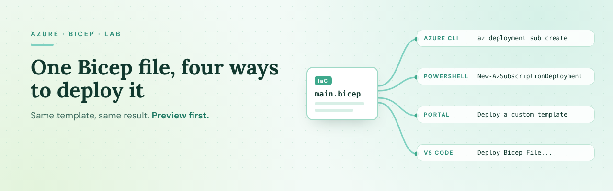

# Azure Bicep Network Basics



**Level:** Beginner  
**Technology:** Azure, Bicep  
**Focus:** Networking, Infrastructure as Code, deployment options

A small Azure network written in Bicep: one resource group, one virtual network, two subnets and one NSG (Network Security Group) per subnet. It is the Bicep version of [Lab 01 with Terraform](https://github.com/Solisys-Cloud/azure-terraform-devops-lab/tree/main/labs/01-azure-networking), so the two tools can be compared on the same architecture.

| Read more | Link |
|---|---|
| Blog article for this repository | [One Bicep File, Four Ways to Deploy It](https://www.solisys.be/blog/deploy-bicep-four-ways/) |
| Same lab with Terraform | [azure-terraform-devops-lab, Lab 01](https://github.com/Solisys-Cloud/azure-terraform-devops-lab/tree/main/labs/01-azure-networking) |
| What the default NSG rules really allow | [Two Azure Subnets, Two NSGs](https://www.solisys.be/blog/two-azure-subnets-two-nsgs/) |

## Architecture

| Resource | Name | Configuration |
|---|---|---|
| Resource group | `rg-lab01-network-dev-weu-002` | West Europe |
| Virtual network | `vnet-lab01-network-dev-weu-002` | `10.10.0.0/16` |
| Application subnet | `snet-app-dev-weu-002` | `10.10.1.0/24`, private subnet |
| Management subnet | `snet-mgmt-dev-weu-002` | `10.10.2.0/24`, private subnet |
| Application NSG | `nsg-app-dev-weu-002` | Azure default rules only |
| Management NSG | `nsg-mgmt-dev-weu-002` | Azure default rules only |

Names end with `002` so this lab can run next to the Terraform version (`001`) without touching it.

> **Security note:** Separate subnets with default NSG rules do not provide full network isolation. The default rule `AllowVNetInBound` still allows traffic between the two subnets.

## Files

| File | Role | Terraform equivalent |
|---|---|---|
| `main.bicep` | Entry point, subscription scope, creates the resource group | `main.tf`, `variables.tf`, `outputs.tf` |
| `modules/network.bicep` | Virtual network, subnets and NSGs | Resources in `main.tf` |
| `main.bicepparam` | Parameter values | `terraform.tfvars` |
| `docs/deploy-four-ways.md` | Azure CLI, PowerShell, portal and VS Code deployment guide | |

## Terraform and Bicep side by side

| Topic | Terraform | Bicep |
|---|---|---|
| State | State file | No state file: Azure is the source of truth |
| Preview | `terraform plan` | `az deployment sub what-if` |
| Deploy | `terraform apply` | `az deployment sub create` |
| Subnet to NSG link | Separate association resource | Property of the subnet |
| Default outbound access | Provider default (`true`) | Set explicitly to `false` (private subnets) |
| Clean up | `terraform destroy` | Delete the resource group |

## Quick start

Requirements: Azure CLI 2.53 or later and a **dedicated test subscription**.

```powershell
az login
az account set --subscription "<your-test-subscription-id>"

# 1. Preview: expect 4 resources to create and nothing to modify
az deployment sub what-if --name lab01-bicep --location westeurope `
  --template-file main.bicep --parameters main.bicepparam

# 2. Deploy, with a final confirmation
az deployment sub create --name lab01-bicep --location westeurope `
  --template-file main.bicep --parameters main.bicepparam --confirm-with-what-if

# 3. Verify the subnets
az network vnet subnet list --resource-group rg-lab01-network-dev-weu-002 `
  --vnet-name vnet-lab01-network-dev-weu-002 `
  --query "[].{Subnet:name, Prefix:addressPrefix, Outbound:defaultOutboundAccess}" --output table
```

If the preview shows **Modify** instead of **Create**, resources with the same names already exist: stop and change the names in `main.bicepparam`.

Other ways to deploy the same files, with Azure PowerShell, the Azure portal or Visual Studio Code: see the [deployment guide](docs/deploy-four-ways.md).

## Clean up

```powershell
az group delete --name rg-lab01-network-dev-weu-002 --yes
```

## Safety and cost

Every command that changes Azure is run manually after a what-if review. The GitHub workflow only lints and builds the templates: it never deploys. The resources in this lab carry no direct charge at the time of writing, but always review Azure pricing and remove lab resources when finished.

## License

[MIT](LICENSE)

Maintained by Olivier Lumeau, Solisys SRL. [solisys.be](https://www.solisys.be)
