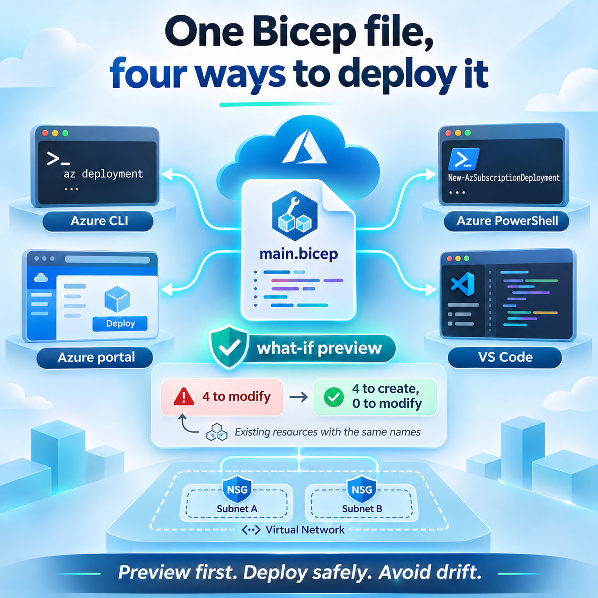

# Four Ways to Deploy a Bicep File

[Back to the README](../README.md) · Blog article: [One Bicep File, Four Ways to Deploy It](https://www.solisys.be/blog/deploy-bicep-four-ways/)

<p align="center"></p>

The same Bicep template, deployed four different ways. The example used throughout is this repository: one resource group, one virtual network, two subnets and two NSGs (Network Security Groups), deployed at subscription scope.

| # | Tool | Best for |
|---|---|---|
| 1 | Azure CLI | Everyday use and CI/CD (Continuous Integration and Continuous Deployment) pipelines |
| 2 | Azure PowerShell | PowerShell users and existing Az module scripts |
| 3 | Azure portal | A one-off deployment without local tools |
| 4 | Visual Studio Code | Writing, checking and deploying from one place |

## Before you start

```powershell
git clone https://github.com/Solisys-Cloud/azure-bicep-network-basics.git
cd azure-bicep-network-basics
```

The folder contains:

| File | Role |
|---|---|
| `main.bicep` | Entry point, subscription scope, creates the resource group |
| `modules/network.bicep` | Virtual network, subnets and NSGs |
| `main.bicepparam` | Parameter values |

> **Tip:** Always run a **what-if** first. It shows what will be created, modified or deleted, and changes nothing.

## 1. Azure CLI

The simplest option: the Azure CLI installs and runs Bicep by itself.

```powershell
# Preview
az deployment sub what-if --name lab01-bicep --location westeurope `
  --template-file main.bicep --parameters main.bicepparam

# Deploy (shows the what-if again and asks for confirmation)
az deployment sub create --name lab01-bicep --location westeurope `
  --template-file main.bicep --parameters main.bicepparam --confirm-with-what-if
```

## 2. Azure PowerShell

The Az module needs the Bicep CLI on the `PATH`. Install it once:

```powershell
winget install -e --id Microsoft.Bicep
```

Then sign in, select the subscription, preview and deploy:

```powershell
Connect-AzAccount
Set-AzContext -Subscription "<your-subscription-name>"

# Preview
New-AzSubscriptionDeployment -Name lab01-bicep -Location westeurope `
  -TemplateFile main.bicep -TemplateParameterFile main.bicepparam -WhatIf

# Deploy
New-AzSubscriptionDeployment -Name lab01-bicep -Location westeurope `
  -TemplateFile main.bicep -TemplateParameterFile main.bicepparam
```

## 3. Azure portal

The portal deploys ARM (Azure Resource Manager) JSON templates, so compile the Bicep file first:

```powershell
az bicep build --file main.bicep --outfile main.json
```

Then in the portal:

1. Search for **Deploy a custom template**.
2. Select **Build your own template in the editor**.
3. Select **Load file**, choose `main.json`, then **Save**.
4. Fill in the parameters, select **Review + create**, then **Create**.

> **Alternative:** open **Cloud Shell** from the portal toolbar, upload the files and run the Azure CLI commands from option 1. The Azure CLI and Bicep are already installed there.

## 4. Visual Studio Code

Install the Bicep extension from Microsoft and open the folder:

```powershell
code --install-extension ms-azuretools.vscode-bicep
code .
```

In Visual Studio Code:

- **Deploy:** right-click `main.bicep`, then **Deploy Bicep File...** Sign in, then pick the subscription, the region and `main.bicepparam`.
- **Visualize:** right-click `main.bicep`, then **Open Bicep Visualizer** to see a diagram of the resources.
- **Write safely:** the extension gives autocompletion and flags errors as you type.

## Recommended workflow

1. **Write and check** in Visual Studio Code with the Bicep extension.
2. **Preview** with `az deployment sub what-if`.
3. **Deploy** with `az deployment sub create`.
4. **Automate** the same Azure CLI commands later in a pipeline.

## Clean up

```powershell
az group delete --name rg-lab01-network-dev-weu-002 --yes
```

## References

- [Bicep documentation](https://learn.microsoft.com/en-us/azure/azure-resource-manager/bicep/)
- [Deploy Bicep files with the Azure CLI](https://learn.microsoft.com/en-us/azure/azure-resource-manager/bicep/deploy-cli)
- [Deploy Bicep files with Azure PowerShell](https://learn.microsoft.com/en-us/azure/azure-resource-manager/bicep/deploy-powershell)
- [Bicep what-if](https://learn.microsoft.com/en-us/azure/azure-resource-manager/bicep/deploy-what-if)
- [Bicep extension for Visual Studio Code](https://learn.microsoft.com/en-us/azure/azure-resource-manager/bicep/install#visual-studio-code-and-bicep-extension)
